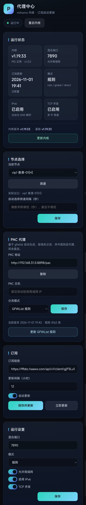

# 代理中心（proxyhub）

面向飞牛 fnOS 的 mihomo 代理管理界面：订阅自动拉取、节点切换、节点测速、内核一键更新，界面保持简单，共六张卡片（运行状态、节点选择、PAC、订阅、运行设置、日志）。

默认混合端口 **7890**，Web 端口 **8898**，打包为 `.fpk`。

## 界面预览



## 功能

- **订阅管理**：粘贴订阅链接自动拉取配置，校验后重启内核；支持定时自动更新
- **节点切换**：下拉选择策略组节点，实时生效
- **节点测速**：组内节点并发测速，显示延迟，自动跳过流量/到期等信息条目
- **内核更新**：通过当前代理从 GitHub 下载新版 mihomo，校验后原子替换，启动失败自动回滚
- **运行设置**：混合端口、运行模式、日志级别、允许局域网、IPv6、TCP 并发、访问密码
- **日志查看**：应用日志与内核日志，按大小自动轮转
- **访问密码**：设置后管理接口需要登录；PAC 与健康检查始终公开
- **PAC 分流**：基于 gfwlist 自动生成 PAC，按域名分流（命中走代理，其余直连）
- **卸载清理**：卸载时可选择保留数据，或删除订阅、设置、PAC 规则与日志

## 安装

1. 下载 `proxyhub-1.5.1-x86.fpk`
2. 飞牛应用中心 → 手动安装
3. 打开「代理中心」→ 设置订阅链接 → 保存
4. 首次会自动拉取订阅并启动内核

> 包内已内置 mihomo **v1.19.34** 内核，以及 `Country.mmdb` / `GeoSite.dat` / `GeoIP.dat` 地理数据；首次启动直接复制到应用数据目录，无需联网下载。缺失或损坏时才自动从镜像重新拉取。
> 如需更新内核，可在「运行状态」卡片点「更新内核」。
> 首次打开建议到「运行设置」里设置访问密码，避免同一局域网内的其他设备直接管理。
> 密码通过 HTTP 明文传输，仅适用于可信局域网；如需公网访问，请置于 HTTPS 反向代理之后。

## 数据与卸载

- 应用数据保存在飞牛应用数据目录，包含订阅链接、节点配置、生成的 `config.yaml`、PAC 规则、日志与内核备份。访问密码以加盐 SHA-256 保存，不存明文。
- `app.log` 与 `core.log` 各保留一份 `.1` 备份，单个文件达到上限后自动轮转。
- 忘记访问密码时，停止应用后删除 `settings.json` 里的 `access_password` 字段，再启动即可恢复免登录。
- 地理数据优先使用安装包内置的 `Country.mmdb` / `GeoSite.dat` / `GeoIP.dat`，首次启动复制到数据目录。
- 在应用中心卸载时会弹出向导：
  - **保留数据（默认）**：重装后订阅与设置自动恢复。
  - **删除所有数据**：删除上述全部数据，不可恢复。
- 删除操作通过 `cmd/uninstall_callback` 执行，并校验目标路径必须是本应用数据目录。

## 配置

| 配置项 | 默认值 | 说明 |
| --- | --- | --- |
| 混合端口 | 7890 | HTTP/SOCKS 混合代理端口 |
| 控制器端口 | 9091 | mihomo 控制接口，被占用时自动避让 |
| Web 端口 | 8898 | 管理界面端口，由 fnOS 服务参数固定 |
| 运行模式 | rule | rule / global / direct |
| 自动更新 | 开启，12 小时 | 定时拉取订阅 |
| IPv6 | 关闭 | 出站与 DNS 解析启用 IPv6 |
| TCP 并发 | 关闭 | 多 IP 竞速 |
| 自动测速间隔 | 关闭 | 仅调优 url-test 策略组，30–86400 秒 |
| PAC 分流模式 | gfwlist | gfwlist / global |
| PAC 主机 | 自动 | 手动指定 PAC 里使用的代理主机 |
| 访问密码 | 未启用 | 设置后管理接口需要登录，至少 6 位；连续 5 次失败锁定 30 秒，会话 30 天过期 |

## PAC

应用内置 PAC 服务，地址为 `http://<NAS地址>:8898/pac`：

- 内置 gfwlist 快照（2026-10-31，4100+ 条），启动不联网
- 页面显示当前版本与规则数，点「更新 PAC」才联网拉取最新规则
- 代理地址默认用本机局域网 IP + Web 端口（经反向代理访问时同样得到内网地址），也可在「运行设置 → PAC 主机」手动指定
- 例：`PROXY 192.168.1.10:7890; DIRECT`
- 系统/浏览器把「自动代理配置」指向该地址即可生效

## 构建

需要 Go 1.24+。内核默认使用仓库内的 `app/bin/mihomo`（v1.19.34），也可用 `CORE_BIN` 指定其他内核：

```bash
./build/build.sh x86
# 或
CORE_BIN=/path/to/mihomo ./build/build.sh x86
```

产物：`dist/proxyhub-<version>-x86.fpk`。

`app/share/geo/` 缺少文件时，构建脚本会自动调用 `build/fetch-geo.sh` 从 jsDelivr / gcore / GitHub 下载。

包内同时包含：

- `bin/mihomo`：v1.19.34（linux amd64 compatible）
- `share/geo/`：`Country.mmdb`、`GeoSite.dat`、`GeoIP.dat` 及来源说明

## 说明

- 内核基于 [MetaCubeX/mihomo](https://github.com/MetaCubeX/mihomo)（GPL-3.0），本项目仅提供管理界面与打包
- 地理数据来自 [MetaCubeX/meta-rules-dat](https://github.com/MetaCubeX/meta-rules-dat)，随包内置，缺失时从镜像更新
- 订阅内容由服务商提供，请遵守当地法律法规与服务条款
- 默认监听局域网，请勿直接暴露到公网

## 许可证

MIT License，Copyright (c) 2026 superqiuc。


## 支持项目

如果这个项目对你有帮助，欢迎请作者喝杯咖啡。捐赠完全自愿，不影响任何功能。


**支付宝**：打开支付宝 → 扫一扫 → 扫描上方二维码。
