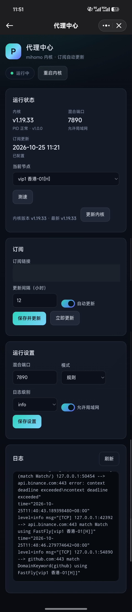

# 代理中心（proxyhub）

面向飞牛 fnOS 的 mihomo 代理管理界面：订阅自动拉取、节点切换、节点测速、内核一键更新，界面保持简单，只保留四个卡片。

默认混合端口 **7890**，Web 端口 **8898**，打包为 `.fpk`。

## 界面预览



## 功能

- **订阅管理**：粘贴订阅链接自动拉取配置，校验后重启内核；支持定时自动更新
- **节点切换**：下拉选择策略组节点，实时生效
- **节点测速**：组内节点并发测速，显示延迟，自动跳过流量/到期等信息条目
- **内核更新**：通过 GitHub 镜像下载新版 mihomo，校验后替换，失败自动回滚
- **运行设置**：混合端口、控制器端口、运行模式、日志级别、允许局域网
- **日志查看**：应用日志与内核日志
- **PAC 分流**：基于 gfwlist 自动生成 PAC，按域名分流（命中走代理，其余直连）

## 安装

1. 下载 `proxyhub-1.1.0-x86.fpk`
2. 飞牛应用中心 → 手动安装
3. 打开「代理中心」→ 设置订阅链接 → 保存
4. 首次会自动拉取订阅并启动内核

> 包内已内置 mihomo 内核；如需更新，可在「运行状态」卡片点「更新内核」。

## 配置

| 配置项 | 默认值 | 说明 |
| --- | --- | --- |
| 混合端口 | 7890 | HTTP/SOCKS 混合代理端口 |
| 控制器端口 | 9091 | mihomo 控制接口，被占用时自动避让 |
| 监听端口 | 8898 | Web 管理界面 |
| 运行模式 | rule | rule / global / direct |
| 自动更新 | 开启，12 小时 | 定时拉取订阅 |

## PAC

应用内置 PAC 服务，地址为 `http://<NAS地址>:8898/pac`：

- 内置 gfwlist 快照（2026-10-31，4100+ 条），启动不联网
- 页面显示当前版本与规则数，点「更新 PAC」才联网拉取最新规则
- 代理地址默认用本机局域网 IP + Web 端口；反向代理访问时会自动改用内网 IP，也可在「运行设置 → PAC 主机」手动指定
- 例：`PROXY 192.168.1.10:7890; DIRECT`
- 系统/浏览器把「自动代理配置」指向该地址即可生效

## 构建

需要 Go 1.24+ 和一个 mihomo 内核二进制：

```bash
CORE_BIN=/path/to/mihomo ./build/build.sh x86
```

产物：`dist/proxyhub-<version>-x86.fpk`。

## 说明

- 内核基于 [MetaCubeX/mihomo](https://github.com/MetaCubeX/mihomo)（GPL-3.0），本项目仅提供管理界面与打包
- 订阅内容由服务商提供，请遵守当地法律法规与服务条款
- 默认监听局域网，请勿直接暴露到公网

## 许可证

MIT License，Copyright (c) 2026 superqiuc。


## 支持项目

如果这个项目对你有帮助，欢迎请作者喝杯咖啡。捐赠完全自愿，不影响任何功能。


**支付宝**：打开支付宝 → 扫一扫 → 扫描上方二维码。
